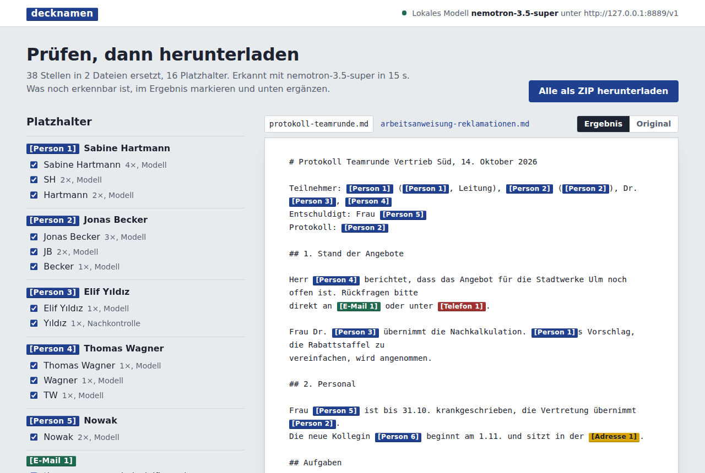

# decknamen

Dokumente pseudonymisieren, bevor sie das Haus verlassen, mit einem Sprachmodell, das im
eigenen Netz läuft.

Wer Protokolle, Arbeitsanweisungen oder E-Mails mit einem Cloud-Modell weiterverarbeiten will,
schickt sonst Namen, Telefonnummern und Anschriften mit. decknamen ersetzt diese Angaben vorher
durch Platzhalter wie `[Person 1]` oder `[E-Mail 2]`. Auf Wunsch anonymisiert es weitergehend:
auch Funktionen, Abteilungen, Datumsangaben und Gesundheitsangaben, mit einem
Restrisiko-Bericht zum Schluss. Erkannt wird mit einem **lokalen**
Sprachmodell (vLLM, llama.cpp, Ollama, LM Studio oder jedem anderen OpenAI-kompatiblen Server).
Die Dokumente gehen nur an dieses Modell.



*English summary: a small local web app that pseudonymizes Markdown, Word and PDF files using a
local LLM. It refuses to talk to non-local model endpoints, loads nothing from the internet,
and lets you review every replacement before downloading the result as Markdown.*

## Was es tut

1. **Einlesen:** Markdown, Text, Word (`.docx`) und PDF. Aus Word und PDF wird Markdown;
   Überschriften, Listen und Tabellen bleiben erhalten. Kopf- und Fußzeilen werden mitgenommen
   und mit pseudonymisiert. Kommentare, Dokumenteigenschaften (Autor, letzter Bearbeiter) und
   eingebettete Bilder fallen weg. Eingescannte PDFs und Bilder (PNG, JPG, TIFF) liest
   Tesseract, wenn es installiert ist; bei gemischten PDFs nur die Seiten ohne Textebene.
2. **Feste Muster:** E-Mail-Adressen, Telefonnummern und IBANs (mit Prüfsumme) findet ein
   regulärer Ausdruck. Diese Angaben sind auch dann weg, wenn das Modell sie übersieht.
3. **Sprachmodell:** Der Text geht abschnittsweise an das lokale Modell. Es meldet Namen (auch
   Vornamen, Nachnamen und Kürzel wie „SH“), Anschriften, Kennungen und auf Wunsch Firmen und
   Orte. Jeder Fund muss wörtlich im Text stehen, sonst wird er verworfen.
4. **Gemeinsame Platzhalter:** „Sabine Hartmann“, „Hartmann“, „Hartmanns“ und „SH“ werden alle
   zu `[Person 1]`, über alle Dateien eines Auftrags hinweg. Ein Kürzel ohne Zuordnung geht an
   den einzigen Namen mit passenden Anfangsbuchstaben.
5. **Nachkontrolle (abschaltbar):** Das Modell liest das Ergebnis noch einmal und meldet, was
   übrig geblieben ist.
6. **Prüfen:** Im Browser steht jede Ersetzung mit Häufigkeit und Herkunft. Haken weg, wenn
   etwas zu Unrecht ersetzt wurde. Was noch erkennbar ist, im Text markieren und ergänzen.
7. **Herunterladen:** Markdown je Datei oder alles als ZIP.
8. **Zurückübersetzen:** Die Antwort eines externen Modells, die mit den Platzhaltern
   arbeitet, lässt sich wieder in echte Namen zurückübersetzen. Die Zuordnung gibt es auch als
   JSON.

## Anonymisieren

Beim Hochladen lässt sich statt „Pseudonymisieren“ auch „Anonymisieren“ wählen. Dann geht
decknamen weiter:

1. **Kein Schlüssel:** Die Zuordnung gibt es weder als Download noch zum Zurückübersetzen.
   Der Auftrag wird spätestens nach einem Tag gelöscht.
2. **Anreden und Titel fallen weg:** Aus „Frau Dr. Yıldız“ wird `[Person 3]`, nicht
   „Frau Dr. [Person 3]“.
3. **Datumsangaben werden verallgemeinert:** „am 14. Oktober 2026“ wird „Mitte Oktober 2026“,
   „bis 31.10.“ wird „bis Ende Oktober“.
4. **Kontext wird ersetzt:** Funktionen und Rollen (`[Funktion 1]` statt „Leitung“),
   Abteilungen und Teams (`[Einheit 2]`) und besondere Angaben wie Gesundheit, Religion oder
   Abmahnungen. Für Letztere schlägt das Modell eine neutrale Formulierung vor
   („krankgeschrieben“ wird „abwesend“).
5. **Restrisiko-Bericht:** Am Ende liest das Modell den fertigen Text, als kenne es alle
   Beteiligten, und nennt die Stellen, an denen man trotzdem erkennen könnte, um wen es geht,
   mit Grund und Vorschlag. Der Bericht liegt dem ZIP als `restrisiko.md` bei.

Das ist eine **Vorlage für die Prüfung von Hand, keine Garantie**. Ob ein Text anonym im
Sinne der DSGVO ist, hängt davon ab, wer ihn liest und was diese Person weiß (Erwägungsgrund
26). Das kann kein Werkzeug prüfen. Was der Bericht anspricht, lässt sich in der Prüfansicht
als Begriff ergänzen. Danach den Bericht neu erstellen lassen.

## Was es nicht tut

- **Anonymität garantieren.** Pseudonymisierte Texte bleiben personenbezogen im Sinne der
  DSGVO. Wer die Zuordnung hat, kann sie auflösen, und der Kontext verrät oft genug („die
  Leiterin des Vertriebs Süd“, „krankgeschrieben bis 31.10.“). Der Modus „Anonymisieren“ nimmt
  auch diesen Kontext heraus und benennt das Restrisiko. Ob der Rest weitergegeben werden
  darf, bleibt eine eigene Entscheidung.
- **Fehlerfrei erkennen.** Auch ein gutes Modell übersieht etwas. Deshalb gibt es die
  Prüfansicht, und deshalb sollte man sie benutzen.
- **Handschrift zuverlässig lesen.** Tesseract kommt mit sauberen Scans gut zurecht, mit
  Handschrift und schlechten Fotos kaum. Erkennungsfehler verstümmeln auch Namen
  („Mül1er“), die dann leicht stehen bleiben. Per Texterkennung gelesene Seiten sind in der
  Prüfansicht gekennzeichnet.
- **Word-Dateien zurückschreiben.** Das Ergebnis ist Markdown, nicht `.docx`.

Ersetzt wird immer das ganze Wort an jeder Stelle. Heißt jemand Koch, wird auch „der Koch“
ersetzt. Das ist die sichere Richtung; in der Prüfansicht fällt es auf.

## Datenschutz im Aufbau

- **Nur lokale Modelle.** Die LLM-Adresse muss auf eine nicht öffentliche IP zeigen: Loopback,
  private Netze, Link-Local oder 100.64.0.0/10 (Tailscale). Geprüft wird beim Start und vor
  jeder einzelnen Anfrage. Wer bewusst anders will, muss `--erlaube-entferntes-llm` angeben.
- **Kein Proxy.** Umgebungsvariablen wie `HTTP_PROXY` werden für Modellanfragen ignoriert.
- **Nichts von außen.** Die Oberfläche bringt alles selbst mit: keine CDN, keine Webfonts. Die
  Content Security Policy verbietet dem Browser jede Verbindung zu einer anderen Adresse.
- **Ablage nur für den eigenen Benutzer.** Ordner `0700`, Dateien `0600`. Gespeichert wird der
  herausgelöste Text, nicht die hochgeladene Datei. Nur Scans liegen bis zur Texterkennung
  selbst in der Ablage; die Seitenbilder entstehen in einem temporären Verzeichnis, das danach
  gelöscht wird. Aufträge werden nach sieben Tagen gelöscht
  (`--aufbewahrung`), auf Wunsch sofort.
- **Passwort im Netz.** Lauscht die Oberfläche nicht nur auf `127.0.0.1`, verlangt decknamen
  ein Passwort (HTTP Basic). Formulare von fremden Seiten werden abgewiesen.

## Installation

Python 3.10 oder neuer.

```bash
git clone https://github.com/DG1001/decknamen.git
cd decknamen
python3 -m venv .venv
.venv/bin/pip install -e .
.venv/bin/decknamen --llm http://127.0.0.1:8000/v1
```

Dann `http://127.0.0.1:8096/` im Browser öffnen.

Für eingescannte PDFs und Bilder zusätzlich Tesseract und Poppler installieren:

```bash
sudo apt install tesseract-ocr tesseract-ocr-deu poppler-utils    # Debian, Ubuntu
brew install tesseract tesseract-lang poppler                     # macOS
```

decknamen findet beides von selbst und meldet beim Start, ob die Texterkennung bereitsteht.

Übliche Adressen lokaler Modellserver:

| Server | `--llm` |
|---|---|
| vLLM | `http://127.0.0.1:8000/v1` |
| llama.cpp (`llama-server`) | `http://127.0.0.1:8080/v1` |
| Ollama | `http://127.0.0.1:11434/v1` |
| LM Studio | `http://127.0.0.1:1234/v1` |

Ohne `--modell` nimmt decknamen das erste Modell, das der Server meldet.

### Im eigenen Netz bereitstellen

```bash
umask 077; openssl rand -base64 18 > ~/.config/decknamen.passwort
.venv/bin/decknamen --adresse 192.168.1.20 --passwort-datei ~/.config/decknamen.passwort
```

Der Benutzername ist beliebig, nur das Passwort zählt. Die Oberfläche läuft auf dem
eingebauten Werkzeug-Server. Das reicht für ein Team im eigenen Netz; über das Internet gehört
sie nicht, auch nicht hinter einem Proxy.

## Optionen

| Option | Umgebungsvariable | Vorgabe | |
|---|---|---|---|
| `--llm` | `DECKNAMEN_LLM` | `http://127.0.0.1:8000/v1` (vLLM) | OpenAI-kompatibler Endpunkt |
| `--modell` | `DECKNAMEN_MODELL` | erstes gemeldetes | Modellname |
| `--adresse` | `DECKNAMEN_ADRESSE` | `127.0.0.1` | Adresse der Oberfläche |
| `--port` | `DECKNAMEN_PORT` | `8096` | |
| `--daten` | `DECKNAMEN_DATEN` | `./daten` | Ablage der Aufträge |
| `--aufbewahrung` | `DECKNAMEN_AUFBEWAHRUNG` | `7` | Tage bis zum Löschen |
| `--passwort-datei` | `DECKNAMEN_PASSWORT_DATEI` | | Passwort aus Datei (oder `DECKNAMEN_PASSWORT`) |
| `--belegung` | `DECKNAMEN_BELEGUNG` | | Belegungsstelle für ein geteiltes Modell |
| `--abschnitt` | | `4000` | Zeichen je Anfrage an das Modell |
| `--ocr-sprachen` | `DECKNAMEN_OCR_SPRACHEN` | `deu+eng` | Sprachen für Tesseract |
| `--ohne-ocr` | | aus | Texterkennung abschalten |
| `--mit-denken` | | aus | Denkmodus des Modells nicht abschalten |
| `--erlaube-entferntes-llm` | | aus | auch öffentliche LLM-Adressen zulassen |

## Welches Modell?

decknamen braucht ein Instruct-Modell, das JSON zuverlässig ausgibt. Wo der Server
strukturierte Ausgabe kennt (`response_format` mit JSON-Schema, z. B. vLLM und llama.cpp),
wird sie genutzt. Der Denkmodus (Qwen3, Nemotron und andere) wird abgeschaltet; er macht die
Erkennung langsamer, aber kaum besser.

Erprobt mit NVIDIA Nemotron 3.5 Super (120B, NVFP4) auf vLLM: zwei Beispieldateien in rund
15 Sekunden, alle Namen, Kürzel und Kontaktdaten erkannt. Kleinere Modelle (7 bis 14 B)
arbeiten auch, übersehen aber mehr. Die Nachkontrolle lohnt sich dann besonders.

### Geteilte GPU

Teilen sich mehrere Anwendungen eine GPU mit einer Belegungsstelle, meldet sich decknamen mit
`--belegung http://127.0.0.1:8930` für die Dauer eines Auftrags exklusiv für das gerade
geladene Modell an. Ein Herzschlag verlängert die Anmeldung alle fünf Minuten, am Ende wird
sie freigegeben. Im Zweck stehen nie Dateinamen, die enthalten oft selbst Namen. Ist die Stelle
nicht erreichbar, läuft die Arbeit ohne sie.

## Entwicklung

```bash
.venv/bin/pip install -e '.[test]'
.venv/bin/python -m pytest
```

Die Tests brauchen kein Modell; ein kleiner Testserver spielt den OpenAI-kompatiblen Endpunkt.
Im Ordner `beispiele/` liegen ein Protokoll (auch als eingescanntes PDF) und eine
Arbeitsanweisung mit erfundenen Namen zum Ausprobieren. Die Tests zur Texterkennung laufen nur,
wenn Tesseract installiert ist.

## Lizenz

MIT, siehe [LICENSE](LICENSE).
